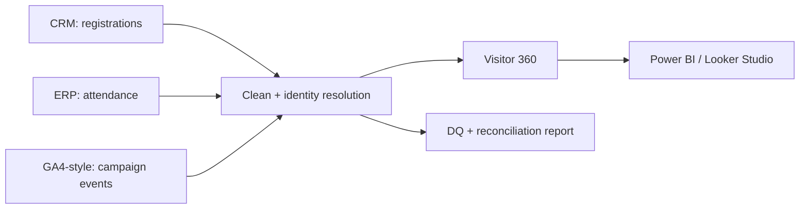

# Exhibition Visitor 360 (Mini Customer Data Platform)

Portfolio project: menyatukan data pengunjung pameran B2B dari 3 sistem yang terpisah menjadi satu tabel
**Visitor 360**, lengkap dengan data quality check, reconciliation, dan dokumentasi teknis.
Semua data **dummy/fiktif** (dibuat dengan script, bukan data perusahaan).

## Problem
Data pengunjung tersebar di 3 sistem dan kotor:

| Sistem (dummy) | Mirip | Masalah yang sengaja dibuat |
|---|---|---|
| `registrations.csv` | CRM | registrasi ganda, email typo/invalid/kosong, format phone campur, nama perusahaan beda-beda (PT / PT. / huruf kecil) |
| `attendance.csv` | ERP / transaksi | scan ganda, ID registrasi beda huruf/spasi, scan tanpa registrasi |
| `campaign_events.jsonl` | GA4 / marketing automation | JSON nested, email huruf besar/spasi, event ganda, kontak tidak dikenal |
| `edition_summary.csv` | laporan resmi | angka total yang harus cocok dengan hasil pipeline |

Akibatnya: jumlah pendaftar/pengunjung tidak cocok antar sistem, dan tidak bisa menjawab "siapa pengunjung loyal?".

## Solution

1. **Cleaning**: normalisasi email (perbaiki typo domain, validasi), phone (+62), nama perusahaan (modus per kunci).
2. **Identity resolution**: record dengan email/phone yang sama = orang yang sama (union-find di Python; versi SQL di BigQuery).
3. **Dedup** registrasi dan scan, **golden record** per orang (isi field kosong dari edisi lain).
4. **Visitor 360**: riwayat hadir lintas edisi, segmen (Loyal / Returning / New / No-Show), engagement campaign.
5. **Data quality score** sebelum vs sesudah, dan **reconciliation** terhadap laporan resmi.

## Result (contoh hasil run, seed 42)
- Data quality score: **75.5% -> 99.0%**
- Registrasi ganda terdeteksi dan dihapus: **12.934 -> 12.218 baris**
- Selisih registrasi vs laporan resmi: **+126..+157 per edisi -> 0..+3**
- Phone format standar: **23% -> 98%**
- Identity resolution vs kunci jawaban: **0% salah gabung**, 99% orang utuh
- Sisa selisih visitor (-7..-18 per edisi) = scan tanpa registrasi yang memang tidak bisa dipetakan

Angka bisa beda sedikit tergantung versi library. Hasil lengkap ada di `output/dq_report.md` setelah dijalankan.

## Cara menjalankan
```
pip install -r requirements.txt
python run_all.py          # atau klik run.bat di Windows
```
Output: `data/raw/` (data dummy), `data/clean/` (tabel bersih + `visitor_360.csv`), `output/` (laporan DQ).

### Versi BigQuery (sandbox gratis)
1. Buat project di Google Cloud (sandbox, tanpa kartu kredit), install `gcloud` SDK.
2. `bash sql/00_load_raw.sh` (atau upload manual, semua kolom CSV sebagai STRING).
3. Jalankan file `sql/00` sampai `sql/07` berurutan di BigQuery Console.
4. Hubungkan tabel `exhibition_cdp.visitor_360` ke Power BI atau Looker Studio. Panduan di `docs/powerbi_guide.md`.

Catatan: tabel di sandbox kedaluwarsa sekitar 60 hari, jadi script SQL di repo ini yang jadi sumber kebenaran.

## Struktur
```
src/        generate_data.py, etl.py, data_quality.py, common.py
sql/        BigQuery: UDF, staging, clean, visitor_360, DQ checks, reconciliation
docs/       data_mapping.md, powerbi_guide.md
```

## Skill yang didemokan
SQL (CTE, window function, UDF, nested JSON), Python (pandas), ETL/ELT, data modeling, data mapping,
data quality (completeness, validity, uniqueness, consistency, integrity), reconciliation, BigQuery, Power BI.
